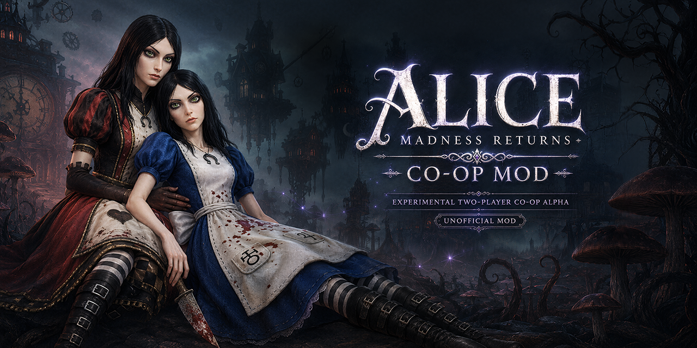
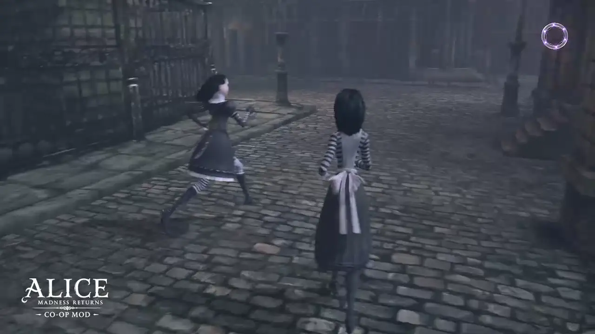
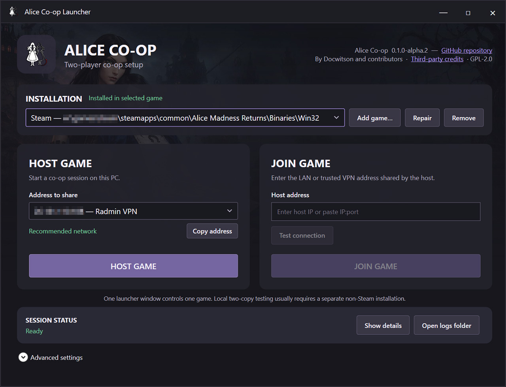

# Alice Co-op



<p align="center">
  <strong><a href="https://www.youtube.com/watch?v=I5nUTZjpCXY">▶ ПОСМОТРЕТЬ ШОУКЕЙС ALPHA.3</a></strong><br>
  <strong><a href="https://www.youtube.com/watch?v=QO0yarqS1-k">▶ ПОСМОТРЕТЬ ТРЕЙЛЕР ПЕРВОГО РЕЛИЗА</a></strong><br>
  <strong><a href="https://www.youtube.com/watch?v=uD7oxI4mNWY">▶ ПОСМОТРЕТЬ ИНСТРУКЦИЮ ПО ЛАУНЧЕРУ И НАСТРОЙКЕ</a></strong><br>
  <strong><a href="https://www.youtube.com/watch?v=j5VLSzZCsK0">▶ ПОСМОТРЕТЬ ПОЛНОЕ 10-ЧАСОВОЕ ПРОХОЖДЕНИЕ (РАННИЕ СБОРКИ)</a></strong><br>
  <strong><a href="https://www.nexusmods.com/alicemadnessreturns/mods/87">⬇ СКАЧАТЬ С NEXUS MODS</a></strong>
</p>

[English](README.md) · [Установка через лаунчер](docs/INSTALL_RU.md) ·
[Ручная установка](docs/MANUAL_INSTALL_RU.md) ·
[Известные проблемы (англ.)](docs/KNOWN_ISSUES.md) · [GPL-2.0](LICENSE)

Alice Co-op — экспериментальный кооперативный мод на двух игроков для Windows-версии
*Alice: Madness Returns*. Каждый игрок запускает собственный процесс игры, а
небольшой UDP-сервер передаёт положение игроков, анимации и состояние мира. Для
обычных противников состояние хоста считается основным.

## Alpha.3.1: исправление режима окна

Alpha.3.1 устраняет принудительное изменение размера окна и исправляет сохранение
режима отображения. Закройте игру и выполните **Install/Repair** новым лаунчером:
обновляется и DLL. Протокол **43** не изменился; публичная Alpha.3 совместима.
Подробнее — в [заметках к hotfix (англ.)](docs/RELEASE_NOTES_0.1.0-alpha.3.1.md).

## Alpha.3

- Улучшены анимации напарника, эффекты оружия и пространственные звуки оружия.
- У удалённой Алисы работают родные симуляции ткани и волос.
- Мультиплеер встроен в оригинальное меню игры: статус подключения, передача
  профиля, About и оформление подсказок в паузе и катсценах.
- Основа обновлена до MadnessPatch 3.3.3 от Wemino и других участников.

Alpha.3 использует **протокол 43**. Обновите обоих игроков и relay; Alpha.2
и тестовые сборки Alpha.3 с другими протоколами несовместимы. Подробности — в
[заметках к релизу (англ.)](docs/RELEASE_NOTES_0.1.0-alpha.3.md) и
[истории изменений (англ.)](CHANGELOG.md).

> [!WARNING]
> Это альфа-версия для плейтестов. Сделайте резервную копию сохранений,
> используйте отдельный кооперативный профиль и будьте готовы иногда перезапускать
> чекпоинт в сложных скриптовых сценах.

## Игровой процесс



*Настоящий игровой процесс Alice Co-op. Баннер — неофициальный
промоматериал с элементами, созданными при помощи ИИ.*

## Что уже работает

- Хост и клиент видят друг друга и независимо управляют своими Алисами.
- Синхронизируются движение напарника, прыжки, полёт, уменьшение, рывки,
  атаки ближнего боя и прицеливание верхней частью тела.
- У удалённой Алисы работают родные симуляции ткани и волос.
- Воспроизводятся следы оружия, снаряды перечницы и чайника с эффектами попаданий,
  ударные волны конька и анимации бомбы, включая появление кролика.
- Оружие напарника слышно в пространстве, включая звуковые события анимаций,
  снаряды и бомбу. Продолжительные звуки останавливаются вместе с источником.
- Позиция, здоровье и смерть обычных мобов синхронизируются от хоста.
- Враги способны менять цель между хостом и клиентом и наносить урон обоим.
- Многие ящики и другие разрушаемые объекты ломаются у обоих; лут остаётся
  индивидуальным.
- Смерть, продолжение с чекпоинта и выход в главное меню координируются.
- Многие катсцены от взаимодействий и триггеров запускаются синхронно.
- Клиент может присоединиться к чекпоинту хоста без замены выбранного профиля.
  Необязательное копирование профиля хоста — отдельное действие с подтверждением,
  проверкой целостности файлов и резервной копией.
- В игре доступны телепорт к напарнику и управление ожиданием общей катсцены.

Это не настоящий встроенный мультиплеер Unreal Engine 3. Оба процесса по-прежнему
локально симулируют часть уровня, а мод согласовывает те состояния, которые можно
безопасно обнаружить во время работы игры.

## Требования

- Лицензионная PC-версия *Alice: Madness Returns* из Steam или EA App.
- Windows 10/11 x64; сама игра и мод 32-битные.
- Microsoft Visual C++ Redistributable 2015–2022 **x86**.
- .NET Framework 4.8 для графического лаунчера.
- Одинаковая версия Alice Co-op на обоих компьютерах.
- Localhost, доверенная локальная сеть или VPN, например Radmin VPN.

В Alice Co-op уже включена объединённая DLL на основе
[MadnessPatch 3.3.3](https://github.com/Wemino/MadnessPatch/releases/tag/3.3.3).
Отдельно устанавливать MadnessPatch не требуется.

## Лаунчер



Графический лаунчер — рекомендуемый способ установки и запуска. Он находит
Steam-версию, поддерживает дополнительные копии игры, управляет relay и
разделяет роли процессов без ручного редактирования BAT- и INI-файлов.

## Быстрый запуск

1. Перед установкой или обновлением закройте обе игры и старый relay.
2. Скачайте `AliceCoop-*-installer.zip` на странице
   [Releases](https://github.com/docwitson/Alice-Madness-Returns-Co-op/releases).
3. Распакуйте его в обычную доступную для записи папку, запустите
   `AliceCoopLauncher.exe`, выберите папку с `AliceMadnessReturns.exe` и нажмите
   **Install/Repair**. Просто открыть новый лаунчер недостаточно: установленная
   DLL от этого не обновляется. Через **Add game** можно добавить вторую копию.
4. На компьютере хоста выберите адрес доверенной локальной сети/VPN, при
   необходимости разрешите сервер в брандмауэре и нажмите **Host Game**.
   Нажмите **Copy address** и передайте скопированный адрес второму игроку.
5. На втором компьютере введите этот адрес, нажмите **Test connection**, затем
   **Join Game**. Для найденной Steam-версии игра запускается через Steam;
   прочие установки запускаются напрямую.
6. Не закрывайте лаунчеры во время сессии. Лаунчер хоста управляет relay, а в
   его журнале должны появиться `HOST connected` и `CLIENT connected`.
7. Выберите профиль в каждой игре. **Multiplayer > Receive host profile** —
   необязательное действие: оно заменяет выбранный профиль клиента прогрессом
   хоста после подтверждения и создаёт резервную копию. Для Join это не требуется.
8. Хост сначала начинает или продолжает игру. Клиент выбирает **Multiplayer > Join host**.
   Игра получает отдельную копию сохранённого чекпоинта хоста и загружает его подобласть
   через нативный Continue, сохраняя выбранный профиль клиента. После подготовки
   нужных частей уровня клиент оказывается рядом с хостом. При таймауте `O` повторяет попытку.

Сервер может работать на компьютере любого игрока. Разрешите входящий UDP для
выбранного порта, по умолчанию `27018`. Не открывайте сервер напрямую в Интернет:
в прототипе нет аутентификации и шифрования.

Полная инструкция по рекомендуемому способу находится в
[руководстве по лаунчеру](docs/INSTALL_RU.md). Архив `drop-in.zip` и запуск
через BAT/INI отделены в [руководство по ручной установке](docs/MANUAL_INSTALL_RU.md)
для опытных пользователей и разработки. Этот процесс также показан в
[видео по устаревшей ручной установке и настройке](https://www.youtube.com/watch?v=UzjCvp7MhTM).

## Управление модом

| Клавиша | Где работает | Действие |
| --- | --- | --- |
| `P` | Геймплей | Телепорт к напарнику: клиент к хосту, хост к клиенту |
| `O` | Геймплей | Клиент: встретиться с хостом в другой части уровня; хост: призвать клиента |
| `L` | Ожидание общей катсцены | Продолжить вместе |
| `T` | Меню паузы | Переключить ограниченную историю следов движения прокси |

P/O при необходимости ждут загрузки частей уровня и работают в полёте.
При таймауте персонаж остаётся на текущем месте.
Подсказки этих действий доступны в меню паузы.

В остальных ситуациях клавиши остаются в распоряжении самой игры.

## Настройка

Лаунчер сохраняет каждую активную сессию отдельно в:

```text
%LOCALAPPDATA%\AliceCoop\sessions\session-<id>.ini
```

Мод принимает её только пока открыт создавший её лаунчер и только для выбранной
копии игры. Поэтому две локальные установки не перезаписывают роли друг друга,
а роль не теряется при перезапуске игры через Steam. Ручные параметры запуска и
полная конфигурация находятся в:

```text
Advanced\Payload\Manual\AliceCoop-LaunchConfig.bat
AliceCoop\AliceCoop.ini
```

В drop-in архиве ручные скрипты находятся в `AliceCoop\Advanced\Manual`. Настройки
MadnessPatch лежат в `MadnessPatch.ini` рядом с exe игры. Смотрите [описание
конфигурации (англ.)](docs/CONFIGURATION.md).

## Основные ограничения

- Боссы и сложные волны мобов иногда расходятся между процессами.
- Некоторые рычаги, пятачки свиней, платформы и секреты остаются локальными.
- Ожидание катсцен основано на эвристиках. Принудительный запуск используйте
  только если оба игрока действительно застряли.
- Уровни с кораблём и видом сбоку специально проходят параллельно в соло-режиме.
- Синхронизация профиля перезаписывает выбранный профиль клиента.

Полный список и способы восстановления находятся в документе
[Known issues and recovery (англ.)](docs/KNOWN_ISSUES.md).

Alpha.2 прошла подробные плейтесты. Alpha.3 в основном меняет анимации, физику,
эффекты, звук и интерфейс и пока не проверялась настолько же плотно. Логика
синхронизации врагов и взаимодействий намеренно не менялась, но регрессии возможны.
Если потребуется вернуться к предыдущей версии, Alpha.2 остаётся в Releases;
откатывать нужно обоих игроков и relay вместе.

## Сборка из исходников

Откройте `AliceCoop.sln` в Visual Studio 2022 и соберите `Release|x86` либо
выполните:

```powershell
& .\tools\Build-AliceCoop-Package.ps1
```

Нужны workload C++ и Windows 10/11 SDK. Результаты компиляции и архивы релиза
исключены из Git. Подробности находятся в
[инструкции для разработчиков (англ.)](docs/DEVELOPMENT.md).

## Происхождение и лицензия

Alice Co-op основан на [MadnessPatch](https://github.com/Wemino/MadnessPatch) от
Wemino и других участников.

Объединённая работа распространяется по лицензии
[GNU GPL version 2.0](LICENSE). Дополнительная информация находится в
[NOTICE.md](NOTICE.md) и [THIRD_PARTY_NOTICES.md](THIRD_PARTY_NOTICES.md).

Проект неофициальный, не связан с Electronic Arts, Spicy Horse, Epic Games или
проектом MadnessPatch и не одобрен ими. Файлы оригинальной игры в репозиторий не
входят.
